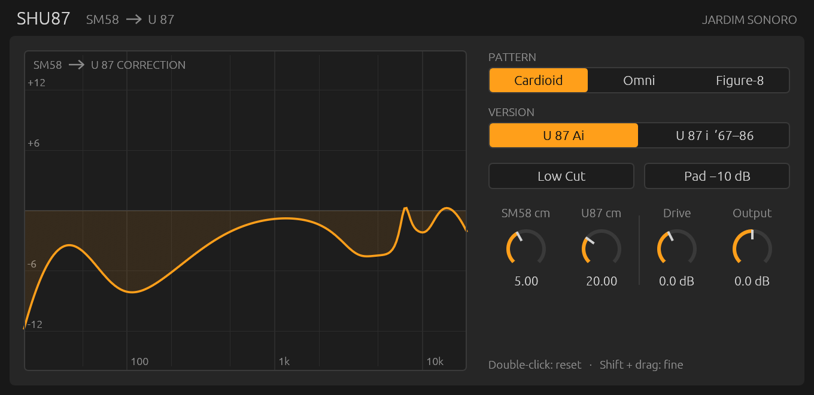
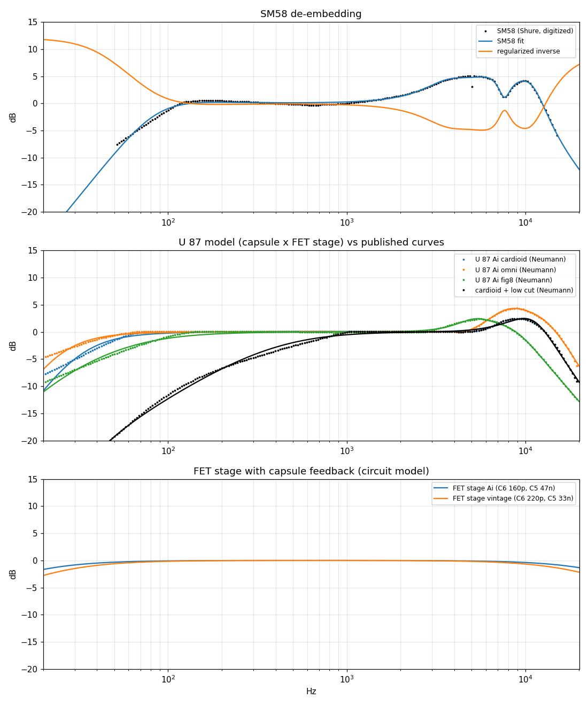

# Shu87 — SM58 → U 87

Plugin de áudio (Audio Unit, macOS Apple Silicon) que transforma o som de um
**Shure SM58** no de um **Neumann U 87**. O modelo foi derivado do esquemático
original do U 87 e das curvas publicadas pela Neumann e pela Shure, e cada
decisão está documentada e é verificada por testes.

Feito por **Jardim Sonoro** com o framework [truce](https://github.com/truce-audio/truce) (Rust).



## Instalação

**Requisitos:** Mac com Apple Silicon (M1 ou mais recente) e um programa que
carregue plugins Audio Unit (Logic Pro, Ableton Live, GarageBand, Reaper,
Studio One, etc.).

1. Baixe `Shu87-<versão>-macos-arm64.zip` na página de
   [Releases](../../releases/latest) e descompacte.
2. Copie `Shu87.component` para a pasta de plugins do seu usuário:
   ```sh
   cp -R Shu87.component ~/Library/Audio/Plug-Ins/Components/
   ```
3. O plugin não é notarizado pela Apple (não há conta de desenvolvedor paga
   por trás dele). Para o macOS aceitar o arquivo baixado, remova a marca de
   quarentena:
   ```sh
   xattr -dr com.apple.quarantine ~/Library/Audio/Plug-Ins/Components/Shu87.component
   ```
4. Peça ao macOS para reler a lista de plugins e confira:
   ```sh
   killall -9 AudioComponentRegistrar
   auval -v aufx Shu8 JdSn      # deve terminar com "AU VALIDATION SUCCEEDED"
   ```
5. Abra o seu DAW. O plugin aparece como **Jardim Sonoro › Shu87**.

Para desinstalar, apague `~/Library/Audio/Plug-Ins/Components/Shu87.component`.

## Como usar

Coloque o Shu87 no início da cadeia de uma faixa gravada (ou monitorada) com
um SM58.

| Controle | O que faz |
|---|---|
| **Pattern** | Padrão polar do U 87: Cardioid, Omni ou Figure-8. Muda o timbre e o efeito de proximidade (em Omni não há reforço de grave por proximidade). |
| **Version** | **U 87 Ai** (atual) ou **U 87 i** (1967–86). Diferem em dois capacitores do circuito: o antigo tem um pouco menos de agudo e de grave. |
| **Low Cut** | Filtro de graves do microfone, como a chave na traseira do U 87. |
| **Pad −10 dB** | Atenuador do microfone: mais folga antes da saturação (e −10 dB de saída, como no real). |
| **SM58 cm** | A que distância da boca o SM58 estava (até a grade). |
| **U87 cm** | A que distância o U 87 "estaria". O plugin remove a proximidade do SM58 e aplica a do U 87. |
| **Drive** | Empurra a eletrônica (FET e transformador). Em 0 dB, 0 dBFS = nível máximo do U 87 real (117 dB SPL, 0,5 % de distorção). O nível de saída é compensado. |
| **Output** | Ganho de saída. |

O gráfico mostra, em tempo real, a correção que está sendo aplicada.
Duplo clique num knob volta ao valor padrão; Shift + arrastar faz ajuste fino.

**Dica:** o modelo assume que a voz está de frente para o microfone. Grave o
SM58 de frente e ajuste **SM58 cm** para a distância real; vozes coladas na
grade normalmente pedem 1–3 cm.

## Como o plugin foi criado

### 1. Pesquisa
Ponto de partida: o BESURE-N87 da Analog Obsession, um plugin gratuito com o
mesmo objetivo, mas sem documentação, só x86_64 e com estalos. Fontes reunidas:

- esquemáticos originais Neumann do U 87 / U 87 i (1972 e 1980);
- folha de dados e curvas de resposta do U 87 Ai, por padrão polar, com e sem low-cut;
- guia do usuário e curva de resposta do SM58 (Shure);
- relatos técnicos sobre as revisões do circuito (GroupDIY, Klaus Heyne via RecordingHacks);
- patentes de modelagem de microfone: US 8 666 090 (Townsend / Universal
  Audio) e US 9 173 046 (Sennheiser).

### 2. A ideia central
Os dois microfones se comportam, em boa aproximação, como sistemas de fase
mínima. Então uma correção de fase mínima ajusta ao mesmo tempo o timbre e a
resposta a transientes. A cadeia é:

```
SM58  →  desfazer o SM58  →  remapear a proximidade  →  cápsula K87  →  [low cut]
      →  FET (lei quadrática)  →  rede de realimentação do U 87  →  transformador  →  U 87
```

### 3. Lendo o esquemático
No U 87, o sinal do dreno do FET volta por C9 ao trilho de polarização e passa
por R8 ‖ C6 até a placa traseira da cápsula, que vai ao terra por C5 + R9 + R10.
Ou seja, **a própria cápsula fica dentro da malha de realimentação negativa**.
Essa rede vira uma função de transferência analítica, e é ela que diferencia as
versões: o U 87 Ai trocou C6 de 220 pF para 160 pF (mais agudo) e C5 de 33 nF
para 47 nF (mais grave). O seletor **Version** usa exatamente esses valores.

### 4. Curvas e ajuste
As curvas publicadas foram digitalizadas automaticamente, rastreando a linha
pixel a pixel (`tools/digitize.py`). Depois foram ajustadas por mínimos
quadrados com filtros analógicos de segunda ordem (`tools/model.py`):

- **Cápsula:** erro RMS de 0,13 a 0,25 dB contra a Neumann nos três padrões.
- **SM58:** a inversa é regularizada; estende o grave só até ~43 Hz e o agudo
  até 16,5 kHz, para não amplificar ruído de manuseio e chiado onde o SM58 não
  capta nada.



### 5. Proximidade
Para um microfone de gradiente a uma distância *r*: `H(s) = 1 + g·c/(s·r)`, em
que *g* é a fração de gradiente do padrão. Trocar o SM58 a *r₁* pelo U 87 a *r₂*
vira um shelf de primeira ordem, calculado a partir das duas distâncias.

### 6. Eletrônica
Distorção calibrada pela folha de dados (0,5 % a 117 dB SPL):

- **FET:** lei quadrática, com predominância de 2º harmônico.
- **Transformador:** saturação do núcleo pelo fluxo (∫V), o que gera 3º
  harmônico só nos graves (∝ 1/f³).

A parte não linear roda com oversampling 2× (half-band FIR, 31 amostras de
latência, informadas ao DAW). Trocar uma chave faz um crossfade de 30 ms, então
não há estalos.

### 7. Verificação
`cargo test` roda 16 testes, entre eles:

- a curva publicada do SM58, passada pelo plugin, cai a menos de 2 dB da curva
  publicada do U 87 nos três padrões polares;
- nenhuma troca de chave ou de knob gera degrau no sinal;
- o processamento não aloca memória na thread de áudio.

O `auval` da Apple passa.

### 8. Comparação com o BESURE-N87
Medido no mesmo host, contra a transformação ideal U 87 ÷ SM58: erro RMS de
0,4 dB (Shu87) contra 2,4 dB (BESURE). Com buffer de 64 amostras, o pior bloco
do Shu87 usa 3,8 % do tempo disponível, contra 303 % do BESURE (o que causa os
estalos dele). Detalhes em [docs/COMPARISON.md](docs/COMPARISON.md).

### 9. O que ficou de fora, e por quê
Foi testado acrescentar as "microrressonâncias" de um pacote comercial de IRs
do U 87. A análise mostrou que o pacote tem só duas capturas independentes e
que o detalhe fino delas não se repete (correlação 0,05). Ou seja, é a
assinatura da sessão de medição, não do microfone. Por isso não entrou
([docs/IR_PACK_ANALYSIS.md](docs/IR_PACK_ANALYSIS.md)).

### 10. Interface
Interface desenhada à mão com egui, no espírito dos dispositivos do Ableton
Live: plana, escura, com destaque laranja. O gráfico é calculado com os mesmos
protótipos analógicos do DSP.

## Limites
- Só a resposta **de frente** é transformada. A sala que o SM58 captou continua
  na gravação; Omni e Figure-8 mudam o timbre e a proximidade, não a captação
  do ambiente.
- Acima de ~16 kHz o SM58 quase não capta nada, e nenhum processamento recria isso.
- Cada SM58 varia ±2–3 dB em torno da curva típica da Shure. Medir o seu e
  trocar `research/data/sm58.csv` (depois `python3 -I tools/model.py`) deixa o
  modelo sob medida.

## Compilar a partir do código

```sh
# Rust 1.92+ e Xcode Command Line Tools
cargo install cargo-truce
git clone https://github.com/nagualcode/shu87 && cd shu87
cargo test --release
cargo truce install --au2        # também: --vst3, --clap
```

Regenerar o modelo (Python 3 com numpy, scipy e matplotlib):

```sh
python3 -I tools/model.py        # ajuste -> src/coeffs.rs + docs/model_fit.png
```

`tools/digitize.py` precisa das imagens das curvas extraídas dos PDFs da
Neumann e da Shure, que não são redistribuídas aqui; os CSVs resultantes estão
em `research/data/`.

## Estrutura

```
src/lib.rs        parâmetros, cadeia de sinal, crossfade
src/dsp.rs        biquads analógico→digital, oversampler, FET, transformador
src/coeffs.rs     protótipos analógicos (gerado por tools/model.py)
src/ui.rs         interface (egui)
src/tests.rs      testes de resposta, proximidade, estalos, tempo real
tools/            digitalização, ajuste, host de medição AU, comparações
docs/MODEL.md     o modelo em detalhe, com fontes
research/data/    curvas digitalizadas (CSV)
```

## Material de pesquisa
Os PDFs, esquemáticos e fotos usados na pesquisa pertencem a Neumann, Shure,
RecordingHacks e outros, e não estão no repositório. Os esquemáticos do U 87
(1972, 1980) e os manuais podem ser encontrados no
[RecordingHacks](https://recordinghacks.com/microphones/Neumann/U-87) e nos
sites dos fabricantes.

---

Shure e SM58 são marcas da Shure Incorporated. Neumann e U 87 são marcas da
Georg Neumann GmbH. Analog Obsession e BESURE pertencem aos seus autores. Este
projeto é independente e não tem afiliação com nenhuma dessas empresas.
