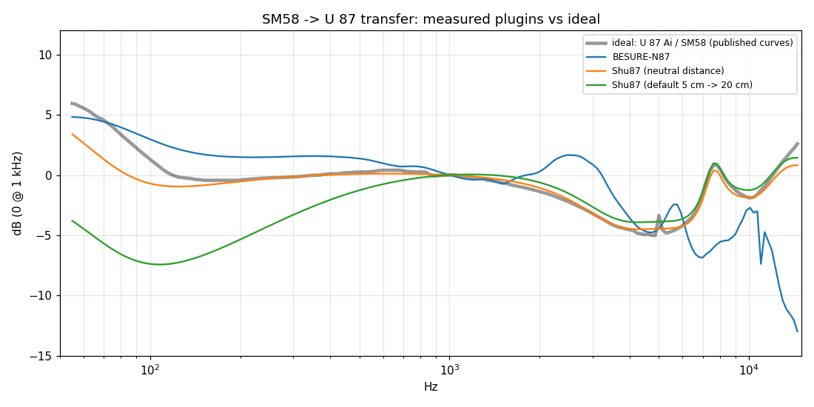

# Comparação medida: Shu87 × BESURE-N87

O BESURE-N87 (Analog Obsession, 2012) é um plugin gratuito com o mesmo objetivo
(SM58 → U 87) e foi o ponto de partida deste projeto. Os dois foram medidos no
mesmo host offline (`tools/auhost.c`), a 48 kHz. Nada do BESURE é usado no
Shu87; a comparação serve só como validação.

## Fidelidade à transformação ideal

Ideal = curva publicada do U 87 Ai (cardioide) ÷ curva publicada do SM58,
normalizada em 1 kHz (`tools/compare.py`):

| 100 Hz – 12 kHz | erro máximo | erro RMS |
|---|---|---|
| BESURE-N87 | 6,8 dB | 2,4 dB |
| Shu87 (distâncias neutras) | 1,9 dB | 0,4 dB |

O BESURE mantém a presença do SM58 em 2–3,5 kHz, aprofunda o vale de 7,5 kHz em
vez de preenchê-lo e fica 6 a 12 dB mais escuro em 12–14 kHz. A curva
"Shu87 (5 cm → 20 cm)" difere do ideal de propósito: ali o plugin também remove
o reforço de grave por proximidade do SM58.

## Desempenho em tempo real

Pior bloco ao longo de 10 s de ruído, em % do tempo disponível
(`tools/besure_measure.py`; o BESURE roda sob Rosetta por ser só x86_64):

| Buffer | BESURE-N87 | Shu87 |
|---|---|---|
| 32 | 552 % | 6,3 % |
| 64 | 303 % | 3,8 % |
| 128 | 137 % | 2,2 % |
| 512 | 30 % | 1,2 % |

Acima de 100 % o host perde o prazo do bloco e ocorre um estalo, o que explica
os cliques do BESURE com buffers de gravação.

## Outras medições

| | BESURE-N87 | Shu87 |
|---|---|---|
| THD 1 kHz, 0 dBFS | 2,1 % (só harmônicos ímpares) | 0,36 % (2º harmônico; o U 87 real: 0,5 % a 117 dB SPL) |
| Entrada só no canal direito | saída em silêncio | processada normalmente |
| Latência reportada | 0 | 31 amostras (oversampling 2×) |
